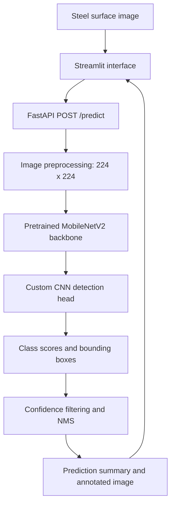

# Industrial Steel Surface Defect Detection and Classification

**End-to-end computer vision application built with Python, TensorFlow, MobileNetV2, FastAPI, Streamlit, Docker, and GitHub Actions.**

[](https://github.com/Ravinuthala-Venkata-Siva-Prasad/Industrial-Surface-Defect-Detection-Using-CNN/actions/workflows/ci.yml)
[](https://github.com/Ravinuthala-Venkata-Siva-Prasad/Industrial-Surface-Defect-Detection-Using-CNN/actions/workflows/docker-build.yml)
[](https://github.com/Ravinuthala-Venkata-Siva-Prasad/Industrial-Surface-Defect-Detection-Using-CNN/actions/workflows/docker-publish.yml)

## Overview

This project explores automated quality inspection of industrial steel surfaces by **detecting, classifying, and localizing defects**. It uses a pretrained **MobileNetV2** backbone with a custom CNN detection head, a **FastAPI** inference service, and an interactive **Streamlit** interface.

The repository includes experiments with **binary cross-entropy (BCE)**, **focal loss**, and **fine-tuning**, along with evaluation reports, Docker-based local deployment, tests, and GitHub Actions workflows.

> **Evaluation note:** This is an experimental detector, not a production-validated inspection system. The validation improvement and final test metrics below refer to different evaluation runs and must not be conflated.

## Application Screenshots

> **Before using these links:** Rename the repository folder `screenshorts` to `screenshots` and rename the four existing files exactly as shown below. Until then, these image links will not render.

### 1. Streamlit dashboard and backend connection

Displays the FastAPI connection status, model loading status, supported defect classes, and image upload interface.


### 2. Defect prediction visualization

Shows an uploaded steel surface image and model-generated bounding-box annotations. The dense overlapping annotations illustrate a current false-positive/visualization limitation.


### 3. Detection summary and threshold controls

Shows adjustable confidence and NMS IoU thresholds, a detection summary, and individual predicted defect entries. The illustrated run displays **36 detections across 2 predicted classes** at a **0.25 confidence threshold**; this is a single UI example, not an accuracy benchmark.


### 4. Backend/model status and prediction completion

Shows the connected FastAPI backend, loaded model, and completed prediction workflow.


## Supported Defect Classes

The model predicts six steel surface defect categories:

1. Crazing
2. Inclusion
3. Patches
4. Pitted surface
5. Rolled-in scale
6. Scratches

## Technology Stack

| Area | Technologies |
|---|---|
| Programming | **Python** |
| Deep learning | **TensorFlow, Keras, CNN, MobileNetV2** |
| Image processing | **OpenCV, Pillow** |
| API | **FastAPI, REST** |
| Web interface | **Streamlit** |
| Packaging and execution | **Docker, Docker Compose** |
| Testing and automation | **Pytest, GitHub Actions** |

## Architecture



The detector processes **224 × 224** images and produces predicted defect classes, confidence scores, and bounding-box coordinates. The interface provides configurable confidence and non-maximum suppression (NMS) settings.

## Model Experiments and Validation Results

Three configurations were compared on the **validation set**:

| Configuration | mAP@0.50 | mAP@0.50:0.95 |
|---|---:|---:|
| Baseline BCE | 15.82% | 4.58% |
| Focal Loss | 20.64% | 6.72% |
| Improved Focal + Fine-Tuning | **22.45%** | **7.79%** |

The fine-tuned configuration improved **validation mAP@0.50 by 6.63 percentage points**, from **15.82% to 22.45%** (**41.9% relative improvement**) compared with the BCE baseline.

**Evidence:** [`results/model_comparison_validation.csv`](results/model_comparison_validation.csv)

> These are **validation** metrics. The best validation configuration is **not** the model named in the available final test report, so its validation result must not be described as final test performance.

## Final Test Evaluation

The repository's recorded held-out test summary evaluates the **Focal_Loss** configuration on **360 images**:

| Metric | Recorded result |
|---|---:|
| Test images | 360 |
| Precision | **23.43%** |
| Recall | **26.70%** |
| F1-score | **24.96%** |
| mAP@0.50 | **16.45%** |
| mAP@0.50:0.95 | **5.46%** |
| True positives | 228 |
| False positives | 745 |
| False negatives | 626 |

Evaluation settings: **confidence threshold 0.60**, **NMS IoU threshold 0.50**, and **matching IoU threshold 0.50**.

**Evidence:**
- [`results/final_test_summary.json`](results/final_test_summary.json)
- [`results/final_test_per_class.csv`](results/final_test_per_class.csv)
- [`results/final_test_map.csv`](results/final_test_map.csv)

### Interpretation

The experiments demonstrate a measurable **validation improvement** from fine-tuning. However, the reported final-test precision, recall, and mAP remain low, and the large number of false positives indicates that additional model and post-processing improvements are needed before practical industrial deployment.

## Application Features

- Upload a steel surface image through **Streamlit**.
- Run inference using a **FastAPI** backend.
- Display predicted defect classes, confidence scores, and localization results.
- Adjust **confidence** and **NMS IoU** thresholds in the interface.
- Inspect backend connectivity and model loading status.
- Run backend and frontend with **Docker Compose**.
- Execute automated tests and GitHub Actions CI workflows.

## Repository Structure

```text
Industrial-Surface-Defect-Detection-Using-CNN/
├── .github/workflows/        # CI, Docker build, Docker publishing
├── app/                      # FastAPI and Streamlit applications
├── data/                     # Dataset files or local data directory
├── models/                   # Saved model assets
├── notebooks/                # Experiments and exploration
├── results/                  # Validation and test evaluation reports
├── screenshots/              # Renamed UI screenshots (see note above)
├── scripts/                  # Utility scripts
├── src/                      # Preprocessing, model and inference code
├── tests/                    # Automated tests
├── Dockerfile.backend
├── Dockerfile.frontend
├── docker-compose.yml
├── requirements.txt
├── requirements.frontend.txt
└── README.md
```

## Getting Started

### Prerequisites

- Git
- Docker and Docker Compose

### Clone and run

```bash
git clone https://github.com/Ravinuthala-Venkata-Siva-Prasad/Industrial-Surface-Defect-Detection-Using-CNN.git
cd Industrial-Surface-Defect-Detection-Using-CNN
docker compose up -d --build
```

| Service | Local address |
|---|---|
| Streamlit UI | http://localhost:8501 |
| FastAPI | http://localhost:8000 |
| Interactive API docs | http://localhost:8000/docs |
| Health endpoint | http://localhost:8000/health |

> The application requires the model assets expected by the repository's inference configuration. Check the `models/` directory and application configuration if model loading fails.

### API Endpoints

| Method | Endpoint | Purpose |
|---|---|---|
| `GET` | `/health` | Backend/model health status |
| `POST` | `/predict` | Run defect inference on an uploaded image |

### Run tests

```bash
pytest -v
```

### Stop services

```bash
docker compose down
```

## CI/CD and Containerization

The repository includes three GitHub Actions workflows:

- [`ci.yml`](.github/workflows/ci.yml): automated continuous integration
- [`docker-build.yml`](.github/workflows/docker-build.yml): Docker build checks
- [`docker-publish.yml`](.github/workflows/docker-publish.yml): Docker image publishing

**Verified successful workflow executions (November 19, 2026):**

- [CI run](https://github.com/Ravinuthala-Venkata-Siva-Prasad/Industrial-Surface-Defect-Detection-Using-CNN/actions/runs/44568230407)
- [Docker build run](https://github.com/Ravinuthala-Venkata-Siva-Prasad/Industrial-Surface-Defect-Detection-Using-CNN/actions/runs/44568230444)
- [Docker publishing run](https://github.com/Ravinuthala-Venkata-Siva-Prasad/Industrial-Surface-Defect-Detection-Using-CNN/actions/runs/44568230486)

Successful CI and image publishing demonstrate workflow execution; they **do not establish that a public production endpoint is live**.

## Limitations and Next Improvements

1. **Reduce false positives:** tune confidence thresholds, NMS, anchors, and detection head behavior.
2. **Improve localization:** inspect bounding-box annotations and per-class failure cases.
3. **Compare with YOLO:** benchmark a YOLO detector against MobileNetV2 using identical train/validation/test splits and consistent metrics.
4. **Test the fine-tuned model:** evaluate the improved fine-tuned configuration on the held-out test set.
5. **Expand diagnostics:** publish per-class precision/recall, confusion analysis, and example success/failure cases.
6. **Measure inference efficiency:** record latency, memory consumption, and throughput on a documented hardware configuration.
7. **Verify deployment:** document any production endpoint only after confirming availability and monitoring.

## Evaluation Artifacts

Detailed experimental results are available in [`results/`](results/), including baseline, focal-loss, fine-tuned validation reports, threshold/NMS sweeps, and final test results.

## Author

**Ravinuthala Venkata Siva Prasad**  
M.Tech — Artificial Intelligence

- [GitHub Profile](https://github.com/Ravinuthala-Venkata-Siva-Prasad)
- [LinkedIn](https://www.linkedin.com/in/ravinuthala-venkata-siva-prasad/)

---

*This repository is an engineering and research portfolio project. Reported performance values are tied to the documented evaluation configurations and datasets.*
