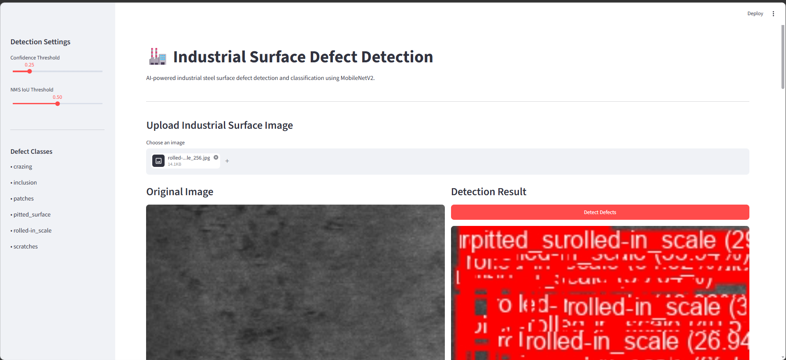
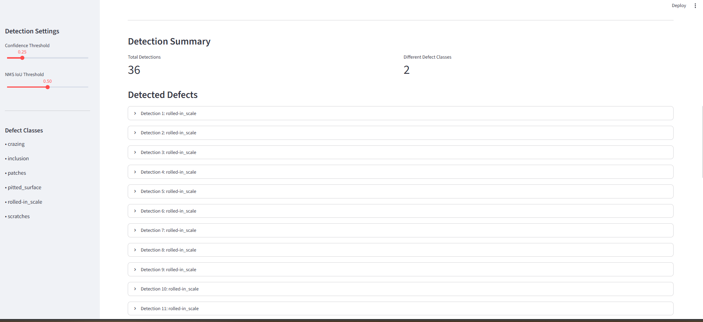
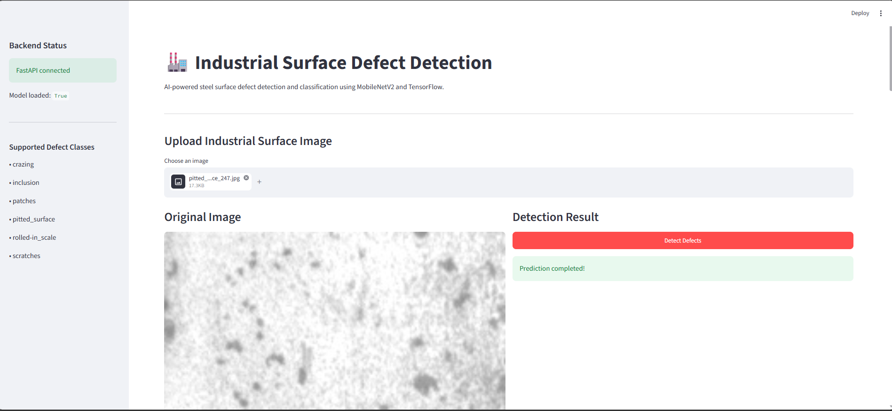
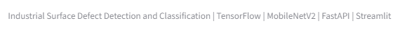
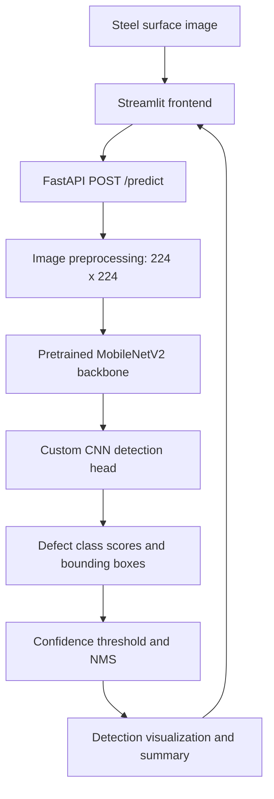

# Industrial Steel Surface Defect Detection and Classification

**An end-to-end deep learning and computer vision application using Python, TensorFlow, MobileNetV2, FastAPI, Streamlit, Docker, and GitHub Actions CI/CD.**

[](https://github.com/Ravinuthala-Venkata-Siva-Prasad/Industrial-Surface-Defect-Detection-Using-CNN/actions/workflows/ci.yml)
[](https://github.com/Ravinuthala-Venkata-Siva-Prasad/Industrial-Surface-Defect-Detection-Using-CNN/actions/workflows/docker-build.yml)
[](https://github.com/Ravinuthala-Venkata-Siva-Prasad/Industrial-Surface-Defect-Detection-Using-CNN/actions/workflows/docker-publish.yml)

## Overview

This project investigates **automated steel-surface quality inspection** through defect **detection, classification, and localization**. It combines a pretrained **MobileNetV2** backbone and a custom CNN detection head with a **FastAPI** inference service and an interactive **Streamlit** application.

The repository includes experiments comparing **binary cross-entropy (BCE)**, **focal loss**, and **fine-tuning**; evaluation reports; local deployment through **Docker Compose**; and automated GitHub Actions workflows.

> **Important:** This is an experimental detection system rather than a production-validated quality-control solution. Validation and final-test metrics refer to different experiments and are reported separately below.

## Application Screenshots

The following screenshots are stored in the existing [`screenshorts/`](screenshorts/) directory. Their paths match the **actual filenames on the `main` branch**; there is no need to rename the folder.

### 1. Streamlit Dashboard and FastAPI Connectivity

Displays the application's image-upload interface, backend connection status, loaded model status, and supported defect categories.



### 2. Steel Surface Defect Prediction Visualization

Shows an uploaded steel image and its prediction visualization. The overlapping annotations in this example highlight a known limitation involving **excess detections and visualization clutter**, not verified high detection accuracy.



### 3. Detection Summary and Adjustable Thresholds

Demonstrates the confidence-threshold and NMS IoU controls, with per-detection expandable entries. This screenshot reports **36 detections** across **2 predicted classes**, at a **0.25 confidence threshold**. These are example UI outputs, **not test-set performance metrics**.



### 4. Backend and Model Status

Shows the FastAPI-connected status, model-loaded indicator, supported classes, and completed prediction workflow.



## Supported Defect Classes

The system supports six steel surface defect categories:

- **Crazing**
- **Inclusion**
- **Patches**
- **Pitted surface**
- **Rolled-in scale**
- **Scratches**

## Technology Stack

| Component | Technologies |
|---|---|
| Language | **Python** |
| Deep learning | **TensorFlow, Keras, CNN, MobileNetV2** |
| Computer vision | **OpenCV, Pillow** |
| API | **FastAPI, REST API** |
| Web interface | **Streamlit** |
| Containers | **Docker, Docker Compose** |
| Quality and automation | **Pytest, GitHub Actions** |

## System Architecture



The detection pipeline accepts steel surface images, resizes them for the model's **224 × 224** input, extracts features with **MobileNetV2**, and produces defect class predictions and bounding-box coordinates. **Confidence filtering** and **non-maximum suppression (NMS)** control the displayed predictions.

## Model Experiments and Measured Improvements

Three detector variants were evaluated on the **validation dataset**.

| Configuration | Validation mAP@0.50 | Validation mAP@0.50:0.95 |
|---|---:|---:|
| Baseline BCE | 15.82% | 4.58% |
| Focal Loss | 20.64% | 6.72% |
| **Improved Focal + Fine-Tuning** | **22.45%** | **7.79%** |

### Quantified improvement

- **Baseline to fine-tuned validation mAP@0.50:** 15.82% → 22.45%.
- **Absolute increase:** **6.63 percentage points**.
- **Relative increase:** **41.9%** over the baseline.
- **Validation mAP@0.50:0.95:** 4.58% → 7.79%.

**Source:** [`results/model_comparison_validation.csv`](results/model_comparison_validation.csv)

> The improvement above was measured on the **validation set**. It must not be described as a final-test improvement. Although the fine-tuned configuration achieved the highest reported validation mAP, it also generated many false positives in that evaluation.

## Final Test Evaluation

The available final test report evaluates the **`Focal_Loss`** configuration, **not** the improved fine-tuned configuration.

| Metric | Result |
|---|---:|
| Test images | **360** |
| Precision | **23.43%** |
| Recall | **26.70%** |
| F1-score | **24.96%** |
| mAP@0.50 | **16.45%** |
| mAP@0.50:0.95 | **5.46%** |
| True positives | 228 |
| False positives | 745 |
| False negatives | 626 |

**Evaluation settings:** confidence threshold **0.60**, NMS IoU threshold **0.50**, matching IoU threshold **0.50**.

**Evidence:**

- [`results/final_test_summary.json`](results/final_test_summary.json)
- [`results/final_test_per_class.csv`](results/final_test_per_class.csv)
- [`results/final_test_map.csv`](results/final_test_map.csv)

### Result interpretation

The experiments demonstrate measurable validation improvements from training changes and fine-tuning, but the final recorded test scores remain low for a reliable defect-inspection application. **False-positive reduction, bounding-box localization, and generalization** are important areas for further work.

## Application Features

- Upload steel surface images through **Streamlit**.
- Connect to the **FastAPI** backend and inspect model-loading status.
- Run predictions for six defect classes.
- Display prediction classes, confidence scores, and localization outputs.
- Adjust **confidence** and **NMS IoU** settings interactively.
- Start backend and frontend services with **Docker Compose**.
- Use **Pytest** and **GitHub Actions** for automated checks.

## Repository Structure

```text
Industrial-Surface-Defect-Detection-Using-CNN/
├── .github/
│   └── workflows/
│       ├── ci.yml
│       ├── docker-build.yml
│       └── docker-publish.yml
├── app/                     # FastAPI and Streamlit components
├── data/                    # Dataset directory
├── models/                  # Model artifacts
├── notebooks/               # Model experiments
├── results/                 # Validation and test reports
├── screenshorts/            # Existing screenshot folder (exact name)
│   ├── 01-steel-defect-detection-dashboard.png
│   ├── 02-steel-defect-prediction-results.png
│   ├── 03-defect-detection-summary.png
│   └── 04-fastapi-model-status.png
├── scripts/                 # Utilities
├── src/                     # Model, preprocessing, inference
├── tests/                   # Automated tests
├── config.yaml
├── Dockerfile.backend
├── Dockerfile.frontend
├── docker-compose.yml
├── requirements.txt
├── requirements.frontend.txt
└── README.md
```

## Quick Start with Docker

### Prerequisites

- Git
- Docker with Docker Compose support
- Model assets expected by the project configuration

### 1. Clone the repository

```bash
git clone https://github.com/Ravinuthala-Venkata-Siva-Prasad/Industrial-Surface-Defect-Detection-Using-CNN.git
cd Industrial-Surface-Defect-Detection-Using-CNN
```

### 2. Build and run the services

```bash
docker compose up -d --build
```

### 3. Open the interfaces

| Service | Local URL |
|---|---|
| Streamlit frontend | http://localhost:8501 |
| FastAPI backend | http://localhost:8000 |
| FastAPI API documentation | http://localhost:8000/docs |
| Health endpoint | http://localhost:8000/health |

> If the backend reports that the model is not loaded, verify that the model assets and paths match the inference configuration in the repository.

### 4. Run tests

```bash
pytest -v
```

### 5. Stop services

```bash
docker compose down
```

## REST API

| Method | Endpoint | Function |
|---|---|---|
| `GET` | `/health` | Check backend and model health |
| `POST` | `/predict` | Run defect detection on an uploaded image |

Use the interactive documentation at **http://localhost:8000/docs** to inspect request parameters and responses.

## GitHub Actions CI/CD

The repository contains three workflows:

- [Continuous Integration](.github/workflows/ci.yml)
- [Docker Build](.github/workflows/docker-build.yml)
- [Docker Image Publishing](.github/workflows/docker-publish.yml)

**Verified successful executions on November 19, 2026:**

| Workflow | Evidence |
|---|---|
| CI | [Successful run](https://github.com/Ravinuthala-Venkata-Siva-Prasad/Industrial-Surface-Defect-Detection-Using-CNN/actions/runs/44568230407) |
| Docker Build | [Successful run](https://github.com/Ravinuthala-Venkata-Siva-Prasad/Industrial-Surface-Defect-Detection-Using-CNN/actions/runs/44568230444) |
| Docker Publishing | [Successful run](https://github.com/Ravinuthala-Venkata-Siva-Prasad/Industrial-Surface-Defect-Detection-Using-CNN/actions/runs/44568230486) |

A successful workflow or container-image publication **does not prove that a public production service is live**.

## Limitations and Roadmap

1. **Reduce false positives:** tune model confidence, NMS, anchors, and post-processing.
2. **Improve bounding boxes:** review label quality, localization loss, and per-class errors.
3. **Benchmark YOLO:** compare YOLO and MobileNetV2-based detection using identical dataset splits and metrics.
4. **Test the fine-tuned model:** generate a held-out final test evaluation for the best validation model.
5. **Improve reproducibility:** document dataset splits, fixed seeds, and model configurations.
6. **Measure inference performance:** report latency and throughput on named hardware.
7. **Validate a production deployment:** monitor a live endpoint before claiming cloud availability.

## Author

**Ravinuthala Venkata Siva Prasad**  
M.Tech in Artificial Intelligence

[GitHub](https://github.com/Ravinuthala-Venkata-Siva-Prasad) · [LinkedIn](https://www.linkedin.com/in/ravinuthala-venkata-siva-prasad/)

---

*All reported performance results are drawn from this repository's published evaluation artifacts. Validation improvements and final test outcomes are reported separately.*
